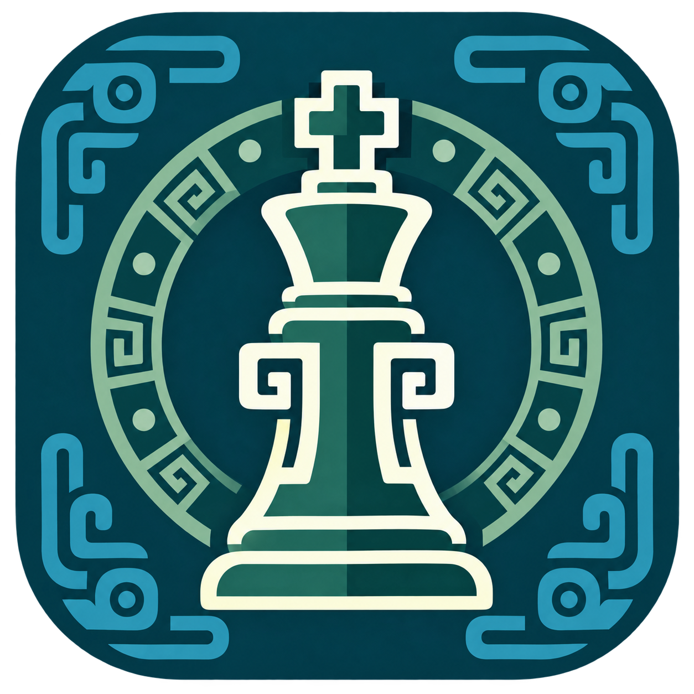
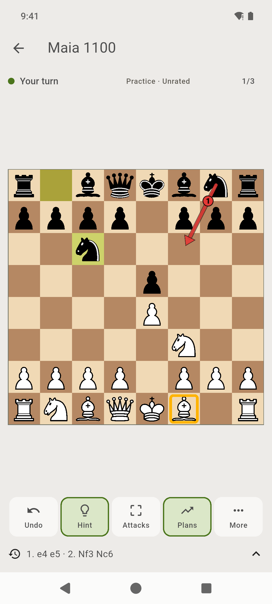
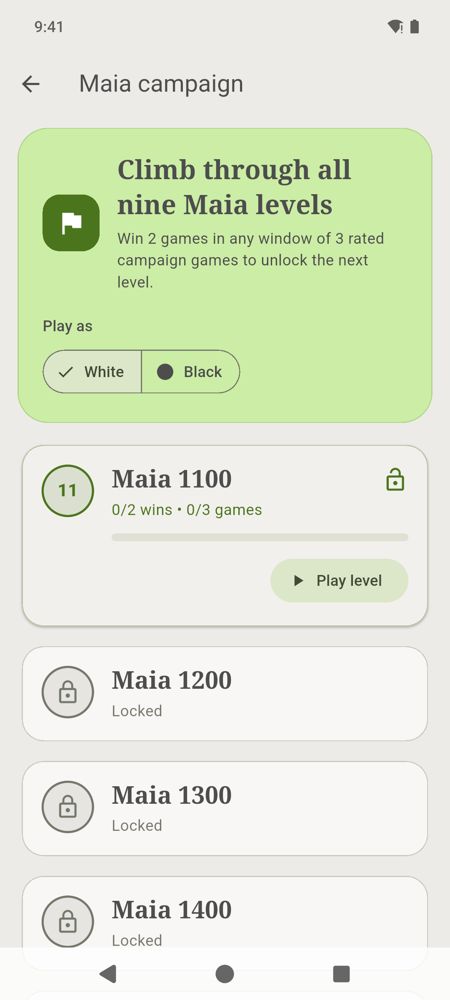
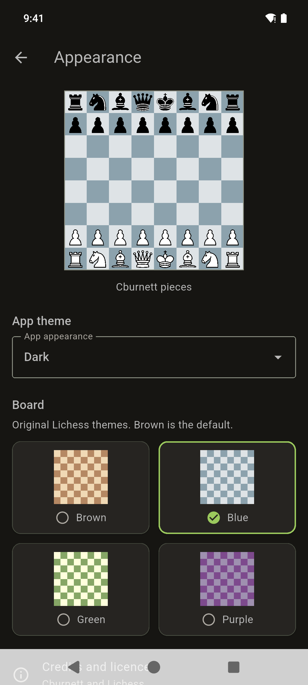

<div align="center">



# Maia Chess

**A human-style opponent, wherever you play.**

Offline chess for Android. Nine Maia opponents, Stockfish practice tools, and a campaign to climb.

[](#get-the-app)
[](#why-maia)
[](LICENSE)

**[Download for Android](https://github.com/lsiddd/maia_chess/releases/latest)** ·
[Screenshots](#a-look-inside) · [How to play](#your-first-game) · [Build from source](#build-from-source)

</div>

Play a quick match against Maia, work your way through the campaign, or share a
board with a friend. Your opponents, practice tools, and saved games run right
on your phone. Open the app and play, even when you're offline.

## Get the app

**[Download the Android APK →](https://github.com/lsiddd/maia_chess/releases/latest)**

You'll need **Android 7.0 or newer on a 64-bit ARM device (ARM64)**. All nine
Maia networks come bundled with the app.

1. Open the download page and select the `.apk` file under **Assets**.
2. Open the downloaded file. If Android asks, allow installation from your
   browser or file manager, then tap **Install**.
3. Launch **Maia Chess** and choose a mode. You're ready to play.

Want the newest development build? [Try the nightly](https://github.com/lsiddd/maia_chess/releases/tag/nightly),
updated after changes to `main` pass CI.

## A look inside

<table>
  <tr>
    <td align="center" width="33%"><strong>Play against Maia</strong></td>
    <td align="center" width="33%"><strong>Climb the campaign</strong></td>
    <td align="center" width="33%"><strong>Make it yours</strong></td>
  </tr>
  <tr>
    <td align="center"></td>
    <td align="center"></td>
    <td align="center"></td>
  </tr>
</table>

## Why Maia?

[Maia](https://github.com/CSSLab/maia-chess) learns from real human games to model
how people play at different rating bands. This app brings the original nine
Maia networks to your phone, with levels from **1100 to 1900**. Each level
represents a different style of human play.

Maia is your opponent; **Stockfish** powers the hints and opponent-plan tools.
Both run locally, so you can practise on the train, on a trip, or anywhere you
want a game.

| What you want to do | What Maia Chess offers |
| --- | --- |
| ♟️ Find an opponent | Choose any of nine Maia levels and play as White or Black. |
| 🏁 Work toward a goal | Start at Maia 1100 and unlock higher campaign levels as you win. |
| 💡 Explore a position | Ask for a hint, inspect attacked pieces, or view possible opponent plans. |
| 🤝 Play with a friend | Two players, one phone. Tap or drag pieces and rotate the board. |
| 📚 Revisit a game | Resume your autosave, replay saved games, and import or share PGN files. |
| 📈 Follow your progress | See your personal in-app rating, winning streaks, and results by Maia level. |
| 🎨 Set the mood | Pick a light, dark, or system theme and one of four Lichess board colours. |

## Your first game

From the home screen, choose how you'd like to play:

- **Free play against Maia:** pick your colour, select any level from 1100 to
  1900, and tap **Start game**.
- **Maia campaign:** start with level 1100. Win two games in a window of three
  rated campaign games at a level to unlock the next opponent.
- **Play (2 local players):** share the phone with a friend and take turns on
  the same board.

Tap a piece and its destination, or drag it to a legal square. Use **More** to
rotate the board, save the game, or change its appearance.

Your ongoing game saves automatically after each move. When you come back,
tap **Continue saved game** to pick up where you left off.

### Practise with a little help

The toolbar keeps useful tools within reach:

| Tool | How to use it |
| --- | --- |
| **Undo** | Try a different idea. Against Maia, return to your previous decision; in local play, take back one move. |
| **Hint** | An amber outline marks the piece Stockfish suggests moving. Work out where you'd like to play it. |
| **Attacks** | Spot attacked pieces: orange for pieces without geometric defence, double blue for defended pieces. Use **More** to show your pieces only or both sides. |
| **Plans** | Explore up to three possible opponent continuations. Tap the counter to cycle through them. |
| **More** | Rotate, restart, save, customise the board, or open the tool guide. |

Your in-app rating and campaign progress track completed, unassisted games
against Maia. Use hints, attacks, plans, and undo whenever you'd like a practice
game.

### Keep a chess notebook

Open **Saved games and PGN** to replay your games move by move. Import a PGN
from your files, or export a game to share it with a friend or open it in another
chess app. During a live game, tap the move history to review the position;
**Current position** brings you back to play.

The library shows 50 games per page. PGN imports accept a single game up to
4 MiB, with at most 20,000 moves including variations and 64 nested variation
levels.

Open **My performance** to see your rating history, current and best winning
streaks, and results against each Maia level.

## Your board, your pace

Choose **Appearance** from the palette icon on the home screen or from the
in-game **More** menu. Match the app to your phone's theme, or select light or
dark mode. Choose a **Brown**, **Blue**, **Green**, or **Purple** board with
Cburnett pieces. Your settings also carry over to game replays.

The board works in portrait and landscape, supports tap and drag controls,
and includes square labels and accessibility announcements. The screen stays
awake while you play.

Your games, settings, statistics, and campaign progress are stored on your
device. You can play without an account or an internet connection and take
your games with you using PGN export.

<details>
<summary><strong>Need a hand?</strong></summary>

- **Maia takes a moment to start:** the first game at a level loads that
  network. Give it a few seconds; use **Try again** if the app offers it.
- **A hint or plan needs another try:** tap **Hint** again, or switch **Plans**
  off and on.
- **Android won't install an update:** updates need the same signing key as
  the installed app. Export your games as PGN before uninstalling an older
  installation, since uninstalling removes its local data.
- **Something else went wrong:** [open an issue](https://github.com/lsiddd/maia_chess/issues)
  with your Android version, app version, and the steps to reproduce it.

</details>

## Build from source

Made with **Flutter and Dart**, with **lc0** running Maia and **Stockfish**
providing assistance. **Riverpod** manages app state and **Drift/SQLite** stores
your games locally.

<details>
<summary><strong>Developer setup and build commands</strong></summary>

Use the toolchain pinned in [.github/workflows/ci.yaml](.github/workflows/ci.yaml):

| Tool | Version |
| --- | --- |
| Flutter / Dart | Flutter 3.47.4 / Dart 3.13.3 |
| Java | JDK 17 |
| Android SDK / build tools | Platform 36 / 36.0.0 |
| Android NDK | 28.2.13676358 |
| CMake | 3.22.1 |

Install Flutter and the Android SDK, add their tools to `PATH`, and configure
`ANDROID_HOME` if your SDK is outside its default location.

```sh
git clone https://github.com/lsiddd/maia_chess.git
cd maia_chess
sdkmanager 'platform-tools' 'platforms;android-36' 'build-tools;36.0.0' 'ndk;28.2.13676358' 'cmake;3.22.1'
flutter doctor --android-licenses
flutter doctor -v
flutter pub get
flutter devices
flutter run -d DEVICE
```

Replace `DEVICE` with your connected Android device or 64-bit emulator ID.
Dependency setup and the native build use the internet, including fetching
Eigen 3.4.0. The Maia networks are already included in the repository.

To build an ARM64 APK:

```sh
flutter build apk --release --split-per-abi --target-platform android-arm64
python3 scripts/verify_apk.py build/app/outputs/flutter-apk/app-arm64-v8a-release.apk
```

The APK is written to `build/app/outputs/flutter-apk/app-arm64-v8a-release.apk`.
Configure `android/app/key.properties` for release signing; local builds use
the debug key when that file is absent. See [Android releases](docs/android-releases.md)
for signing, checks, versioning, and publication.

Run Android builds and integration tests sequentially. After integration tests,
use the normal build command to refresh plugin registration.

</details>

## Join in

Have an idea, found a bug, or want to help? [Open an issue](https://github.com/lsiddd/maia_chess/issues)
or send a pull request. If you enjoy the app, a GitHub star helps other players
find it.

- [Contributing](CONTRIBUTING.md): checks, tests, code generation, and contribution conventions.
- [Architecture](docs/architecture.md): app state, storage, and engine integration.
- [Android releases](docs/android-releases.md): build, signing, and release workflow.

## Licence and credits

Copyright (C) 2026 Maia Chess contributors. Original project code, documentation,
and assets are licensed under the **GNU Affero General Public License, version 3
or any later version (`AGPL-3.0-or-later`)**. See [LICENSE](LICENSE).

Built with the work of the [Maia researchers](https://github.com/CSSLab/maia-chess),
[Leela Chess Zero](https://github.com/LeelaChessZero/lc0),
[Stockfish](https://github.com/official-stockfish/Stockfish), and
[dartchess](https://github.com/lichess-org/dartchess). Board themes come from
Lichess and pirouetti; the piece set is by Colin M. L. Burnett.

Third-party components retain their original licences. See
[THIRD_PARTY_NOTICES.md](THIRD_PARTY_NOTICES.md) for their attribution and terms.
