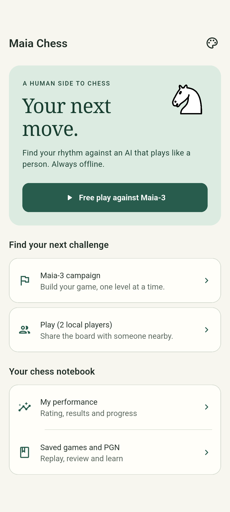
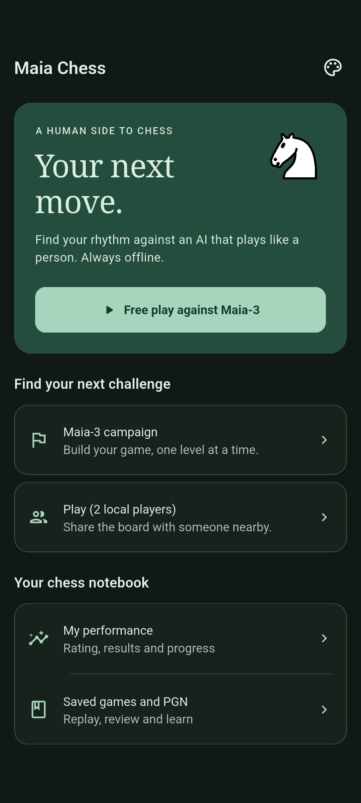
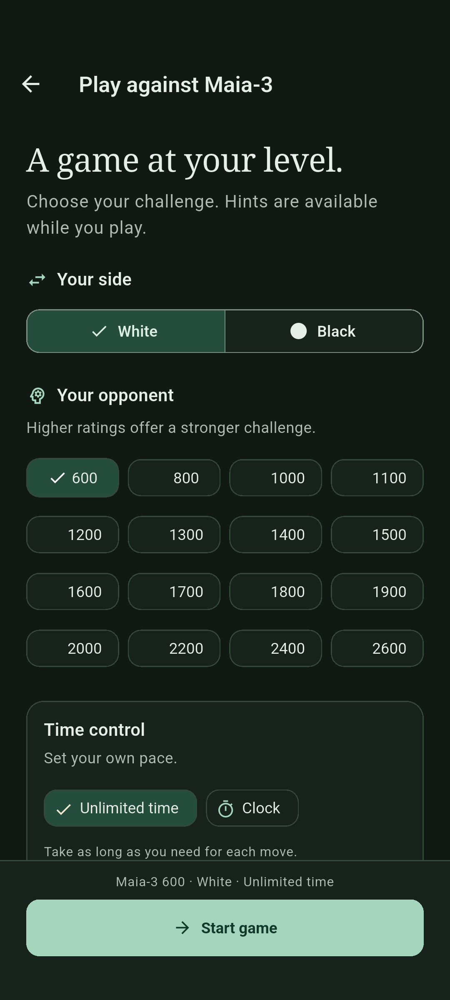
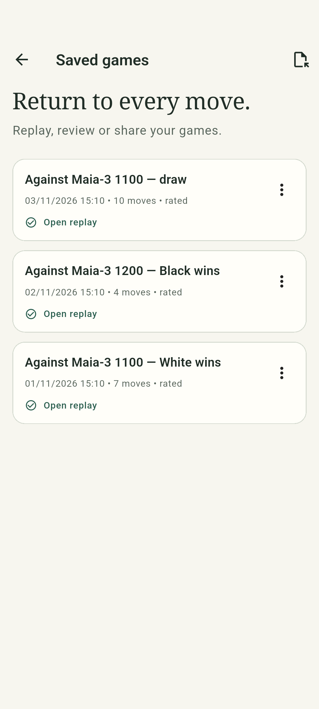
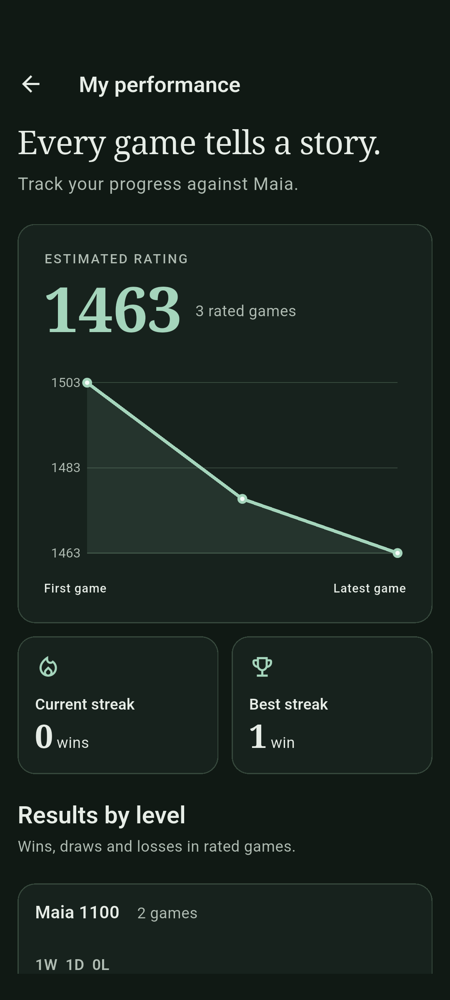
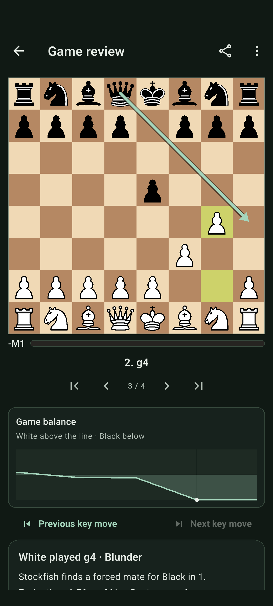

# Android experience redesign

## Direction

Maia is a quiet chess club: forest ink, warm paper, an editorial serif for
headings and ratings, and readable system typography for controls and play.
The board remains the strongest object on the game screen. The app palette
is independent of the user's board palette.

`AppTheme` owns semantic light/dark colours, typography, surfaces, control
shapes, minimum control sizes, sheets, dialogs, fields, feedback, and system
bar contrast. The spacing rhythm is 4/8/12/16/24/32; primary controls have a
52 logical-pixel minimum height and icon actions a 48-pixel minimum target.
Selected controls combine colour with a check, border, label, or semantic state.

## Audit and implemented decisions

| Area | Problem observed | Implemented response |
| --- | --- | --- |
| Home | Similar buttons competed; a saved game lacked context | A single primary action resumes the saved game or opens free play; the saved opponent and move count provide context. Campaign/local play and the chess notebook form separate groups. |
| Free play | Start action fell below a long list of settings | A persistent safe-area footer keeps the configuration summary and start/cancel feedback available while settings scroll. Side selection stacks with large text. |
| Campaign | Configuration and explanatory text preceded the next useful action | Overall progress and the next unlocked challenge lead; setup is expandable and completed/locked levels are quieter. |
| Time | Choosing common clock settings required manipulating wide-range sliders | Four presets plus exact increment/decrement controls complement the original sliders and unlimited mode. Custom values remain supported. |
| Game | Fixed status space, tiny scaled labels, and crowded tools | Compact contextual status, direct save retry, full-size clock text, and a tool strip that scrolls only when needed while More stays reachable. |
| Board/history | Movement ignored reduced-motion settings; history lacked clear button semantics | Piece movement respects reduced motion, and history identifies its action and the selected position. |
| Library/replay | Empty pagination, weak empty states, and loading/error navigation disappeared | Actionable empty state, conditional paging, structured game metadata, persistent replay controls, and a retry path that retains navigation. |
| Review | Android back exited practice/variation instead of returning to the game; graph lacked context | Back returns to the reviewed position; the chart explains its scale and current selection; loading, failure, practice, and continuation states share the same visual language. |
| Performance | Empty state exposed a synthetic initial rating and used fixed-height content | First-use guidance replaces the artificial score; metrics and per-level results wrap with text size; chart and results expose accessible descriptions. |
| Appearance | Theme choices were hidden in a dropdown; preview had fixed dimensions | Direct theme options, adaptive board preview, accessible selected palettes, persistence feedback and recoverable failure. |
| Android shell | Generic launcher name, white startup in dark mode, custom route transition | Maia Chess launcher label, themed launch background, explicit edge-to-edge, safe content insets, native predictive-back route transitions, and reduced-motion handling. |

## Platform decisions

Native Material route transitions are deliberately retained for Android's
predictive back. Material focus, ink feedback, dialogs, sliders and selection
semantics are also retained where they match platform expectations. Their
visual treatment comes from the shared theme instead of isolated screen styles.

References: [Flutter predictive back](https://docs.flutter.dev/platform-integration/android/predictive-back),
[Android accessibility targets](https://developer.android.com/guide/topics/ui/accessibility/views/apps-views),
and [Flutter text scaling](https://docs.flutter.dev/ui/accessibility/ui-design-and-styling).

The chess grid must fit all 64 squares. On narrow devices individual squares
are necessarily smaller than a general 48-pixel action target; the board
preserves tap/drag play, coordinate labels, and existing accessible piece/move
announcements. This exception does not justify shrinking surrounding actions.

## Repeatable visual inspection

The capture suite renders home, free play, campaign, appearance, empty library,
empty statistics, and game in both themes. It also seeds three legal games
for populated library/statistics, replay, and completed native Stockfish review
captures (22 frames total). It uses an in-memory database and
never player data. Captures are generated under ignored `build/ui-audit/`:

```sh
flutter drive --driver=test_driver/ui_audit.dart --target=integration_test/ui_audit_android_test.dart -d DEVICE
```

Widget regressions cover semantic text contrast (at least 4.5:1), 320-pixel
layouts, 200% text, landscape, system insets, persistent actions, reduced motion,
recovery after failed saves/replay, and Android back from review exercises.
The normal suite continues to cover chess rules, promotion, hints, campaign
eligibility, clocks, persistence, model assets and PGN.

## Validation record — 7 November 2026

- Flutter 3.47.4 / Dart 3.13.3, matching CI.
- `flutter analyze --no-fatal-infos`: no issues.
- Repository Dart formatting check and `git diff --check`: passed.
- `flutter test --coverage`: 335 tests passed.
- Python release-tool suite: 13 tests passed; `actionlint`: passed.
- Bundled Maia-3 source model: byte size, level count and SHA-256 verified.
- Android 16 / API 36 ARM64 emulator, 1080×2400 at 420 dpi: debug APK built
  and installed; native acceptance exercised sound, Maia, Stockfish, autosave,
  campaign, hints, undo, clocks, promotion, castling, king escapes and results.
  The full run found one outdated text finder for the redesigned review action;
  it was corrected to the accessible tooltip and both native review tests passed
  on reexecution, including rematch persistence.
- Final Android visual suite: passed, with 22 captured frames and real Stockfish
  review. Inspection led to stable rating-cell geometry, a single clock selection
  mark, grouped game controls, consistent dark surfaces, and populated statistics
  without empty levels. The final frames were inspected after these refinements.

Representative unedited Android frames:

| Home · light | Home · dark | Setup · dark |
| --- | --- | --- |
|  |  |  |

| Library | Statistics | Review |
| --- | --- | --- |
|  |  |  |

The screenshots and native tests establish rendering and functional evidence,
not a new frame-time benchmark. This pass did not include a manual TalkBack
session or predictive-back gesture inspection on a physical phone; the connected
phone disconnected before execution. Semantic regressions and native route/back
handling are covered by tests. Hardware-specific animation/performance and
manual assistive-technology validation remain explicit follow-up checks.
